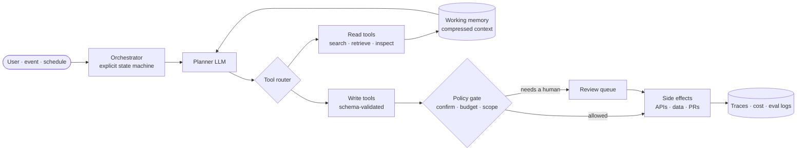
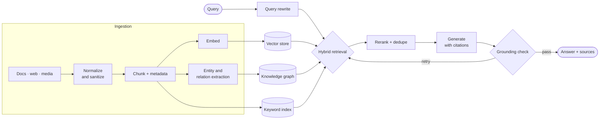
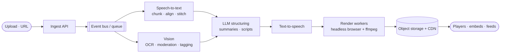
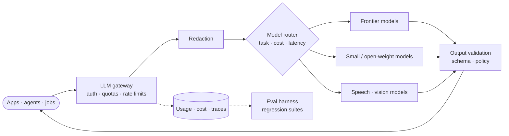

<!-- ============================== HERO ============================== -->

<picture>
  <source media="(prefers-color-scheme: dark)" srcset="https://github-readme-stats.vercel.app/api?username=SecolDevs&show_icons=true&count_private=true&include_all_commits=true&hide_border=true&bg_color=0d1117&title_color=CC342D&icon_color=CC342D&text_color=c9d1d9&custom_title=GitHub%20stats" />
  
</picture>

<h1>Sebastian Colón</h1>

<h3>Sr. Software Engineer · AI Engineer</h3>

📍 Colombia &nbsp;·&nbsp; 🏠 Remote &nbsp;·&nbsp; 🗣️ English & Spanish

I design and ship **production AI systems**: agents, retrieval, and speech and video generation, along with the full-stack platforms they run on. I've been putting LLMs into production since early 2023.

**5 yrs** shipping &nbsp;·&nbsp; **1,000+** merged PRs &nbsp;·&nbsp; **1,700+** commits &nbsp;·&nbsp; **40+** repos

<!-- Add your links here, e.g.

-->

 

<!-- ========================== ACHIEVEMENTS ========================== -->

### 🏆 Achievements

<table>
  <tr>
    <td align="center" width="25%">
       
      <b>Pull Shark</b> <code>x4</code> 
      Gold · 1,024+ merged PRs
    </td>
    <td align="center" width="25%">
       
      <b>Pair Extraordinaire</b> <code>x3</code> 
      Silver · co-authored PRs
    </td>
    <td align="center" width="25%">
       
      <b>Quickdraw</b> 
      Fast turnaround
    </td>
    <td align="center" width="25%">
       
      <b>YOLO</b> 
      Shipped it
    </td>
  </tr>
</table>

---

## 🤖 AI Engineering

<table>
  <tr>
    <td width="33%" valign="top">
      <b>🧠 Agents & tool use</b> 
      Planner and executor loops, typed tools, policy gates, human-in-the-loop approval, context compression, MCP servers.
    </td>
    <td width="33%" valign="top">
      <b>🔎 Retrieval & grounding</b> 
      Hybrid vector, keyword and knowledge-graph retrieval, code-aware indexing, citation-backed generation.
    </td>
    <td width="33%" valign="top">
      <b>🎙️ Speech, voice & video</b> 
      Long-form transcription with diarization, voice-cloned TTS, AI-directed video and motion graphics.
    </td>
  </tr>
  <tr>
    <td width="33%" valign="top">
      <b>🧪 Evals & guardrails</b> 
      Real-model eval suites, output filters, schema validation, redaction, SSRF-safe tools.
    </td>
    <td width="33%" valign="top">
      <b>💸 LLMOps & cost</b> 
      Per-request token and cost tracking, budget ceilings, rate limiting, graceful degradation.
    </td>
    <td width="33%" valign="top">
      <b>🧩 Multi-provider</b> 
      OpenAI, Anthropic, DeepSeek, OpenRouter and ElevenLabs, via LangChain, LangGraph and the AI SDK.
    </td>
  </tr>
</table>

**Highlights**

- 🤖 Built an **autonomous coding agent** that plans, writes code and tests, and opens pull requests. It has **340+ commits** in production repositories.
- 📚 Shipped **LLM content generation** grounded in retrieved, cited sources, with human review before anything is published.
- 🎬 Built **speech and generative-video pipelines**: hour-long recordings to diarized transcripts, and text to voiced, rendered video.
- 🔌 Made a SaaS product **AI-native** with an OAuth 2 provider and an **MCP server**, so AI assistants can act on a user's behalf.
- ⚡ Rolled out my first LLM service in **early 2023** and have kept shipping AI features ever since.

---

## 🏛️ Reference architectures

These are the blueprints I start from when designing AI systems, generalized from years of production work. Client systems are confidential, so these show the approach, not any specific product.

<b>① Tool-gated agent runtime</b>: an agent that can act safely

 

- **The model proposes; code decides.** Read tools run freely, but every write tool passes a policy gate (confirmation, budget, permission scope) before it has side effects.
- **Explicit state machine** instead of an open-ended loop, with recursion limits and resumable steps.
- **Context compression** keeps long sessions inside the token budget without losing the plan.

<b>② Grounded retrieval (hybrid RAG)</b>: answers you can trace to a source

 

- **Three retrievers, one ranking.** Vectors catch meaning, keywords catch exact names, and the graph catches relationships.
- **Citations are required, not optional.** An answer that can't point back to its sources goes back to retrieval or to a human reviewer.
- **Ingestion is part of the product.** Sanitizing, deduplicating and keeping provenance metadata matter more than the choice of embedding model.

<b>③ Multimodal media pipeline</b>: speech, vision and video at scale

 

- **Stream, don't copy.** Pull only the track you need (audio for speech, frames for vision) straight from the source.
- **Chunk, align, then stitch.** Each chunk's timestamps and labels are mapped back onto one shared timeline before results are merged.
- **Rendering is just another worker.** Stateless, horizontally scalable, with frame-level tests on the output.

<b>④ LLM gateway & LLMOps</b>: one control plane for every model call

 

- **Each task gets the cheapest model that passes its evals.** Frontier models are for the hard cases only.
- **Budgets are enforced, not just reported.** Hard ceilings per tenant or feature, with a deterministic fallback when a limit is hit.
- **Evals gate changes.** A model, prompt or provider swap ships only after the regression suite passes.

---

## 🧰 Tech stack

| | |
|---|---|
| **AI / LLM** |             |
| **Vector & graph** |   -FF4438?style=flat-square&logo=redis&logoColor=white)  |
| **Languages** |  |
| **Backend** |        |
| **Frontend** |       |
| **Data** |      |
| **Cloud & DevOps** |          |
| **Quality** |      |

---

## 🧱 Full-stack & platform foundation

AI features are only as good as the platform under them. I also own the rest of the stack:

- **Large production monoliths and microservices.** I keep long-lived Rails codebases healthy (version upgrades, refactors, query tuning) and build Python and Node services alongside them.
- **Multi-tenant SaaS.** Tenant isolation with Postgres row-level security, subdomain routing, and subscription billing.
- **Event-driven back ends.** Queues, background workers, webhooks with signature verification, and real-time sockets.
- **Cloud and infrastructure as code.** Terraform on AWS and GCP, Kubernetes and Cloud Run, and CI/CD across staging, preprod and production.
- **Payments and integrations.** Stripe, Mercado Pago, Shopify, Twilio, and accounting, ad-server and messaging APIs.

---

## 🧠 How I build

- 🔒 **The model writes, code decides.** LLMs never change state directly. Typed tools, validation and human review sit in between.
- 💸 **Cost is a feature.** Token tracking, budget ceilings, and a deterministic fallback when a model is unavailable or over budget.
- 🧪 **Evals before vibes.** Every prompt, model or provider change runs against regression suites built from real-model outputs.
- 🛡️ **Secure by default.** SSRF guards, signed webhooks, rate limiting, redaction, and no secrets in repos.
- 📝 **Write it down.** Architecture docs, ADRs, runbooks, and `AGENTS.md` / `CLAUDE.md` files so humans and AI agents both onboard fast.
- 🤝 **AI-augmented workflow.** I work with Claude Code, Cursor and MCP every day, and I build the tooling that makes teams faster with them.

---

## 💼 Experience

| Period | Domain | Focus |
|---|---|---|
| **2022 – present** | 📰 Media & ad-tech SaaS | AI and full-stack engineering on a large production platform: retrieval-grounded LLM content, speech and generative video, agentic developer tooling, MCP integrations, and the Python and Node AI services around them on GCP. |
| **2022 – 2025** | 🏋️ Vertical SaaS (fitness) | Full-stack product work, AWS infrastructure as code, and an early LLM service (2023). |
| **2022** | 🛒 E-commerce | TypeScript back end and front ends, payments, and real-time features. |
| **2025** | 🚚 Logistics | Optimization service built on linear programming. |
| **2024 – present** | 🚀 Independent studio | AI-first SaaS products for Latin American markets, including conversational agents, multi-tenant platforms and local payments. |

---

## 📈 GitHub activity

<picture>
  <source media="(prefers-color-scheme: dark)" srcset="https://streak-stats.demolab.com?user=SecolDevs&hide_border=true&background=0D1117&stroke=30363D&ring=CC342D&fire=CC342D&currStreakLabel=CC342D&currStreakNum=C9D1D9&sideNums=C9D1D9&sideLabels=8B949E&dates=8B949E" />
  
</picture>

<picture>
  <source media="(prefers-color-scheme: dark)" srcset="https://github-readme-activity-graph.vercel.app/graph?username=SecolDevs&bg_color=0d1117&color=c9d1d9&title_color=CC342D&line=CC342D&point=f0f6fc&area=true&area_color=CC342D&hide_border=true&custom_title=Contribution%20activity" />
  
</picture>

<picture>
  <source media="(prefers-color-scheme: dark)" srcset="https://raw.githubusercontent.com/SecolDevs/SecolDevs/output/github-snake-dark.svg" />
  
</picture>

<!--
Most of my work happens in private org repositories. For the charts above to reflect it:
GitHub → Settings → Public profile → Contributions & activity → enable "Include private contributions on my profile".
The snake is regenerated every 12 hours by .github/workflows/snake.yml (output branch: `output`).
Achievement badges are local copies in assets/achievements/. Swap the image and tier when one levels up.
-->

---

Building AI systems that are useful, affordable, and safe to let act.

